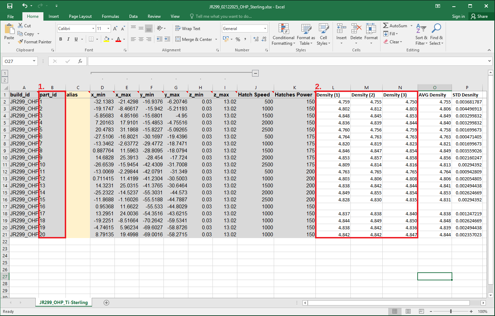

# Excel template

Makes the samples-template workbook for one build, without opening the build.

1. On the File tab, choose **New ▸ Excel template** (or the **Excel template**
   tile).
2. Pick the build's folder.
3. Choose where to save the workbook. The save window starts in the build's
   folder with the build's name, `<build name>.xlsx`; save it anywhere. If a
   file of that name is already there, the save window asks before
   replacing it.

What goes into it depends on what the folder contains:

| Found | Result |
| --- | --- |
| DHXML (with or without the parts CSV) | The full template: one row per part with its bounding box, plus laser parameters when the parts CSV is there. |
| Parts CSV only | A reduced template built from the CSV alone. The result message says so. |
| Neither | Nothing to build from. You are told which files are missing. |

## Filling it in

Each row is a part. The template fills in the grey columns: the build, the
part, its box on the plate (`x_min` to `z_max`) and, from the parts CSV, its
laser parameters. `alias` (yellow) is free for a name of your own. Your
measurements go in new columns to the right.

1. `part_id`, the part's number: the key to bring the measurements in on.
2. Your measurements, here three densities per part.

Bring them into the table with **Add column ▸ Excel**: see
[Adding a column from Excel](help:columns-excel). Three repeats like these are
what a [Mean ± SD plot](help:plot-mean-sd) averages.

This is different from **Export to Excel** on the Data tab, which writes the
data you are looking at. See [Exporting to Excel](help:export-excel).
