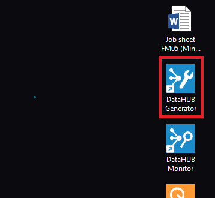
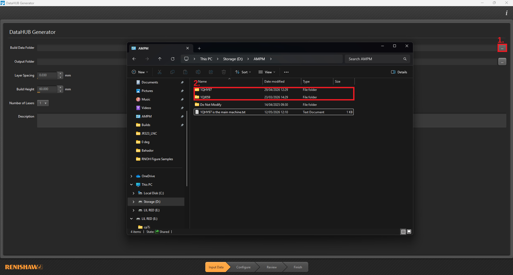
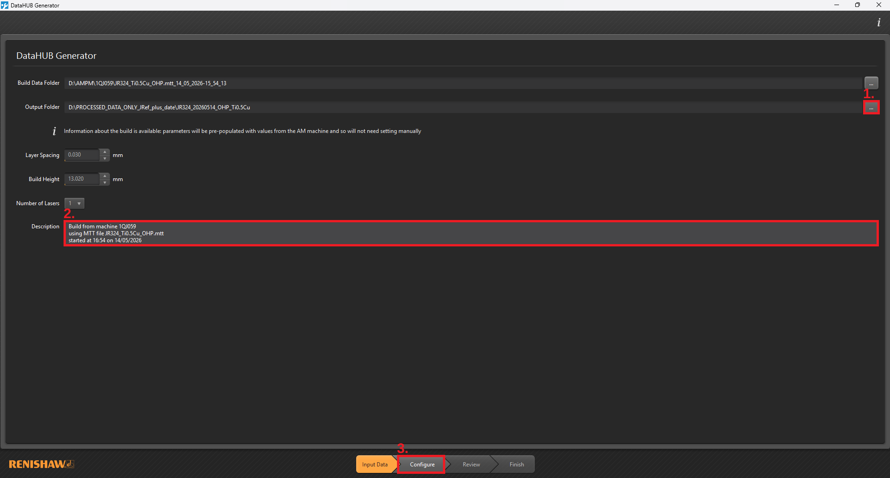
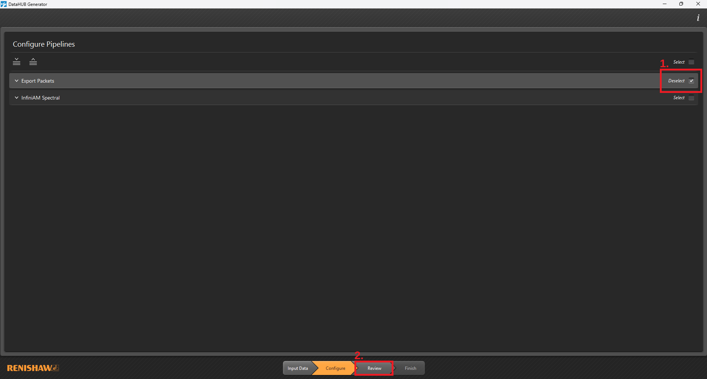
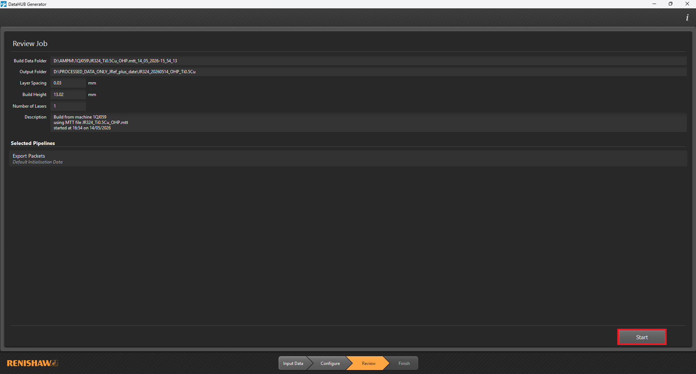
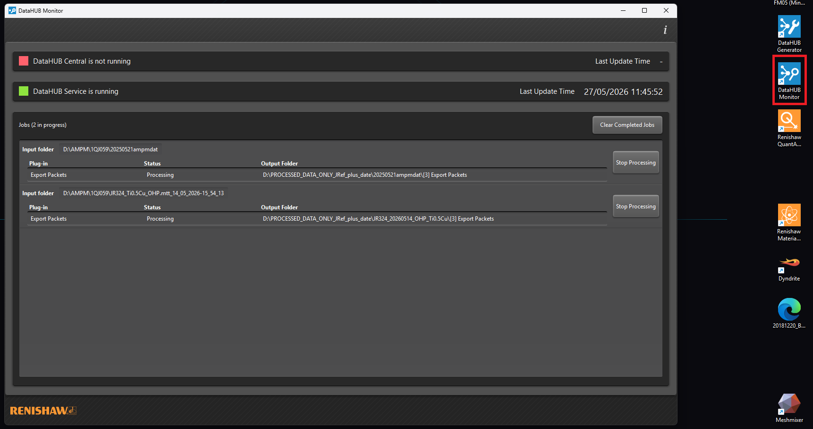
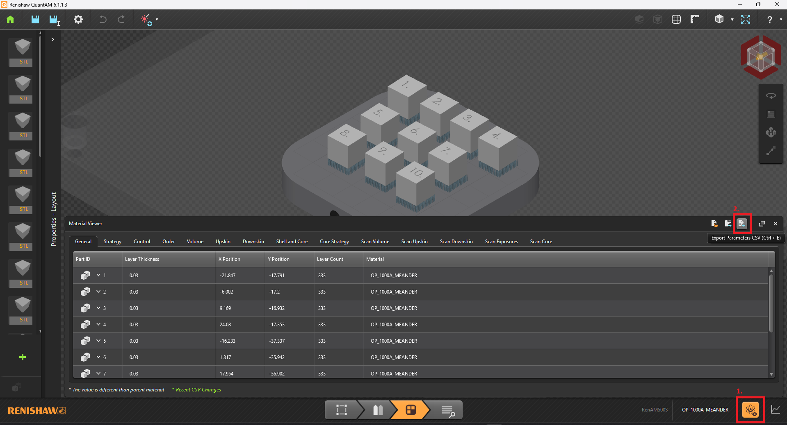
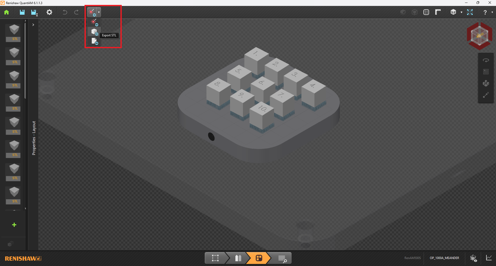
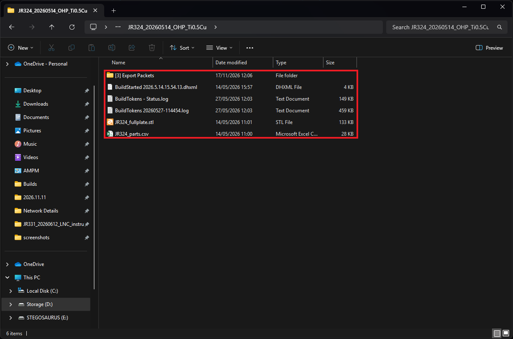

# Exporting a build's data

AMPM Viewer reads a build's melt-pool monitoring data once it has been
exported from the machine's raw `.DAT` files. Renishaw's **DataHUB Generator**
does this, writing one text file per layer: the *packets*. For part features
the app also uses two files from QuantAM, the **parts CSV** and the
**full-plate STL**. This page goes through both. The numbers in each picture
match the steps beside it.

## 1. Start DataHUB Generator

Open **DataHUB Generator** from the desktop.

## 2. Choose the build and the output folder

1. Click **...** next to **Build Data Folder**.
2. Choose the build's folder, under `D:\AMPM\1QHY97\` for the MAIN machine or
   `D:\AMPM\1QJ059\` for the RBV: the folder that holds the build's `.DAT`
   files.

Make a folder for the export in `D:\PROCESSED_DATA_ONLY_JRef_plus_date\`,
named with the job reference and the date (such as
`JR324_20260514_OHP_Ti0.5Cu`). Then:

1. Click **...** next to **Output Folder** and choose that folder.
2. Check the **Description**. The other fields fill themselves in from the
   machine's record of the build; set them by hand if they don't. DataHUB
   won't go on without a description of some kind.
3. Click **Configure**.

## 3. Export the packets

1. Tick **Export Packets**.
2. Click **Review**.

Check the details and click **Start**.

## 4. Follow the export

To see how far it has got, open **DataHUB Monitor** from the desktop. It only
watches: closing it doesn't stop the export. A large build takes a while. The
packets are written to a `[3] Export Packets` folder in the output folder.

## 5. Export the QuantAM files

Open the build's `.amx` in QuantAM.

For the **parts CSV**:

1. Click the atom at the bottom right to open the Material Viewer.
2. Click **Export Parameters CSV**.

For the **STL**, choose **Export STL** from the menu at the top left. It writes
two STLs of the whole plate: one of the parts and one of the supports (ending
`_s`). The app uses the parts one. Name it with `fullplate`, `full` or `plate`
in it (such as `JR324_fullplate.stl`) and it is found on its own.

Save both files into the output folder.

## The finished build folder

The output folder is now a build the app can open: the `[3] Export Packets`
folder, the build's `BuildStarted` `.dhxml`, the full-plate STL and the parts
CSV. Don't rename the exported files.

Next: [Opening a build](help:open-build). What each input is used for is
listed there too.
