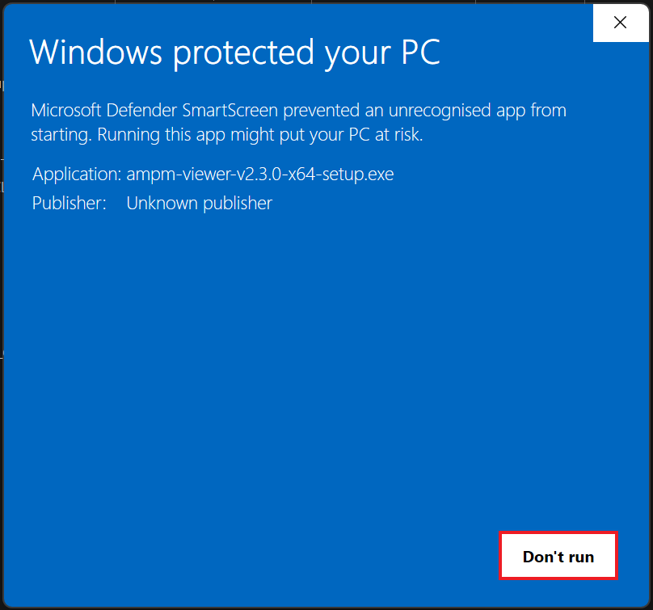
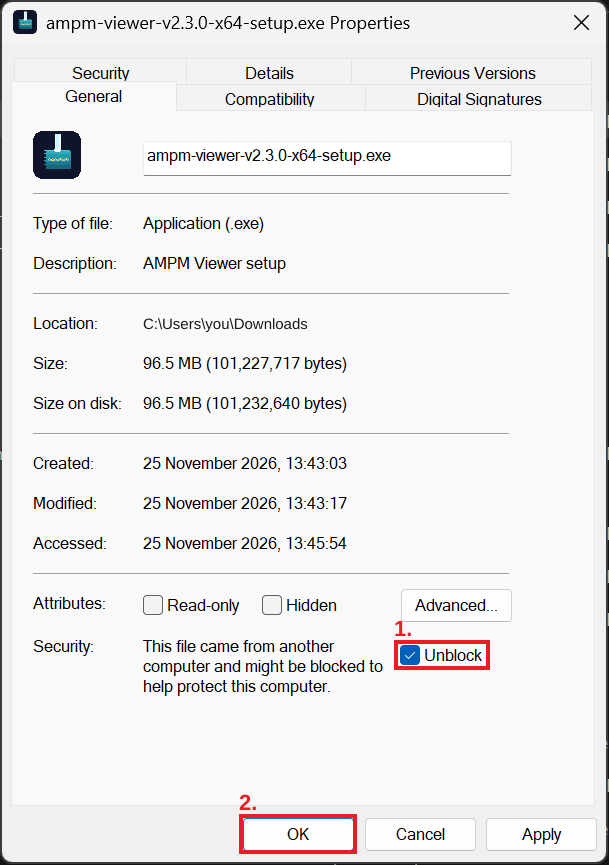
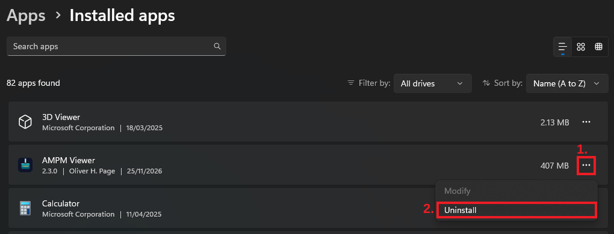
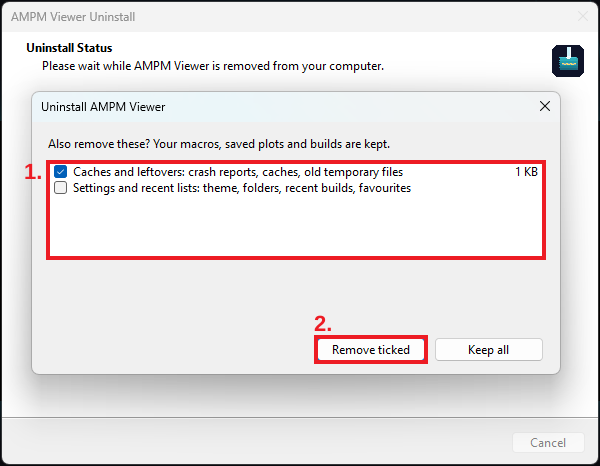

# Installing and uninstalling

## Installing on Windows

Run the setup, `ampm-viewer-v<version>-x64-setup.exe`. It installs AMPM Viewer
for you alone (no administrator needed), adds it to the Start menu and, unless
you untick it, opens `.ampmplot` files from the
[plot library](help:plot-library) with it. To upgrade, run a newer setup: it
replaces the old version, and your settings, macros and plots are kept.

### "Windows protected your PC"

The setup isn't signed yet, so Windows may stop it. If the message has a
**More info** link, click it, then **Run anyway**. If it only offers
**Don't run**, click that:

Then right-click the setup file, choose **Properties**, and:

1. Tick **Unblock**.
2. Click **OK**.

Run the setup again; it now starts.

## Installing on a Mac

Open `ampm-viewer-v<version>-arm64.dmg` and drag AMPM Viewer to Applications,
replacing an older copy. It runs on Macs with Apple silicon. The app isn't
signed yet, so the first time you open it:

- **macOS 15 and later:** open AMPM Viewer, close the warning, then go to
  System Settings ▸ Privacy & Security and click **Open Anyway**.
- **macOS 14 and earlier:** Control-click AMPM Viewer in Applications and
  choose **Open**.

## Uninstalling on Windows

In Windows Settings ▸ Apps ▸ Installed apps:

1. Click **...** beside AMPM Viewer.
2. Click **Uninstall**.

The uninstaller then offers to tidy up what the app leaves behind:

1. Tick what to remove. **Caches and leftovers** (crash reports, caches, old
   temporary files) is ticked to start with; **Settings and recent lists**
   (theme, folders, recent builds, favourites) isn't, so a later install
   starts where you left off.
2. Click **Remove ticked**, or **Keep all** to leave everything.

Your macros, saved plots and builds are never removed.

## Uninstalling on a Mac

Double-click **Uninstall AMPM Viewer** in the disk image. It lists the app and
the same leftovers and settings as on Windows, ticked the same way, and
removes what you leave ticked when you click **Remove**.
