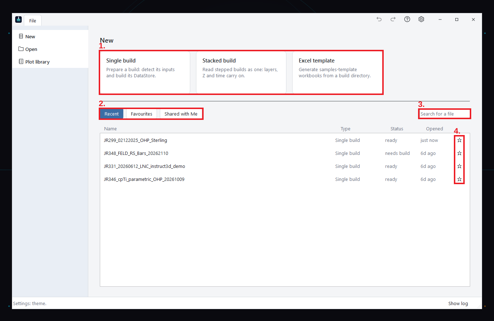
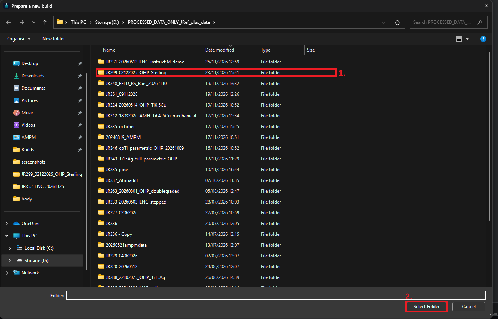

# Opening a build

A *build* is a folder. Point the app at the folder and it finds what it needs
inside.

1. **New**: a single build, a stacked build or an Excel template.
2. The builds you have opened: **Recent**, and your **Favourites**.
3. **Search for a file** narrows the list.
4. The **star** keeps a build under Favourites.

## New or Open?

- **New ▸ Single build** (or the **Single build** tile): for a build you have
  not prepared yet. The app detects the build's inputs and takes you to the
  [DataStore setup](help:datastore-setup) page. If the build already has a
  DataStore, you are asked whether to overwrite it; answer no and the existing
  one simply opens.
- **Open**: for a build that already has a DataStore. It opens straight onto
  the Data tab. If there is no DataStore yet, you are offered to create one.

Both open a folder picker:

1. Choose the build's folder (the one that contains the exported packets),
   not a file inside it.
2. Click **Select Folder**.

**New** also makes a [Stacked build](help:stacked-builds) (a build printed in
steps, read as one) and an [Excel template](help:create-excel).

## Info and Close

Once a build is loaded, **Info** in the File tab's sidebar shows its
properties: its type and folder, how many layers are built and the
DataStore's size on disk, the processing it was built with and its inputs.
**Open build folder** shows the folder.

**Close** in the sidebar closes everything: the build, the Data tab and every
plot, including plots in their own windows and plots from the library. The
app is then as it is when it starts. Nothing is lost: the build's plots,
columns, filters and grid layout are kept with it, and come back when you
open it again. If DBSCAN is still running, or a macro is being recorded,
you are asked first, because those would stop. With nothing open, **Close**
just leads back to the landing page.

## What a build folder contains

| Input | Needed for |
| --- | --- |
| **Packet source**: the folder of exported layer packets | Everything. This is the data. |
| **Parts CSV**: the QuantAM parts export | Part assignment, importing part columns (laser parameters among them), the Excel template. |
| **DHXML**: the `BuildStarted` file | Part assignment by bounding box, the full Excel template. |
| **STL**: the full-plate export | Masking. |

Only the packet source is required. Features that need a missing input are
greyed out, with the reason in their tooltip. How to export these from DataHUB
and QuantAM: [Exporting a build's data](help:export-data).

## Recent builds

The list on the File tab's landing page shows the builds and plot library
plots you have opened, newest first, in columns: the **Type** (*Single build*,
*Stacked build* or *Library plot*), whether a build is **ready** (has a
DataStore) or **needs build**, and when it was **Opened**. Double-click a row
to open it.

- Click the **star** on a row to keep it under **Favourites**.
- Type in **Search for a file** to narrow the list by name.
- Builds whose folder (or plots whose file) no longer exists drop off the
  list.

## See also

- [Exporting a build's data](help:export-data)
- [Setting up the DataStore](help:datastore-setup)
- [Stacked builds](help:stacked-builds)
- [Excel template](help:create-excel)
