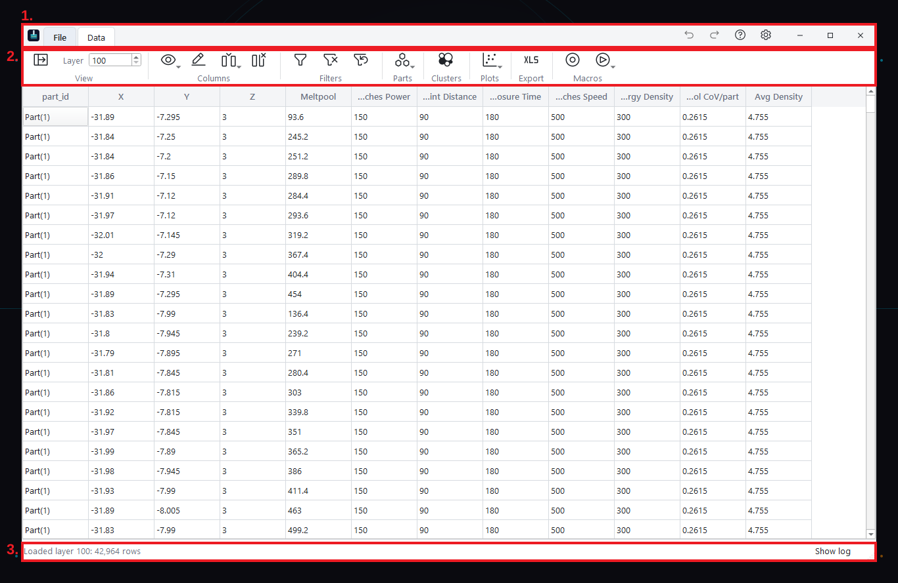

# Welcome to AMPM Viewer

AMPM Viewer turns a build's process-monitoring export into a table you can
shape and a set of plots you can explore. For what that export contains and
what each column means, see [About the data](help:about-data).

A typical session looks like this:

1. **Open a build** from the File tab. The first time, you build its
   *DataStore*, a fast copy of the build's data. See
   [Opening a build](help:open-build) and
   [Setting up the DataStore](help:datastore-setup). The build's data is
   exported from the machine first: see
   [Exporting a build's data](help:export-data).
2. **Shape the data** on the Data tab: add calculated columns, bring in part
   parameters, filter rows. See [The Data tab](help:data-tab).
3. **Plot it.** Each plot opens in its own tab. See
   [Creating a plot](help:plots-create).
4. **Save the routine.** Record the steps as a macro and run it on the next
   build. See [Macros](help:macros).

## The window

| Area | What it is |
| --- | --- |
| **1. Title bar** | The top row. It holds the tabs, then Undo, Redo, Help and Settings, then the minimise, maximise and close buttons. Drag its empty part to move the window; double-click it to maximise. Drag any edge or corner of the window to resize it. |
| **Tabs** | *File* (open and set up builds), *Data* (the table), then one tab per plot. |
| **2. Toolbar** | Under the tabs. Its buttons change with the tab you are on, and come in groups, each named under it (*Columns*, *Filters*, *Macros*...). Hover a button to see its name and its [keyboard shortcut](help:shortcuts). |
| **Side panel** | On the left. Shows the whole grid, or a column's details, on the Data tab, and the appearance controls on a plot. Toggle it with the first toolbar button or **Ctrl+B**. |
| **3. Status bar** | At the bottom: the latest message, progress, and **Show log**, which opens the [log](help:settings-log). |

## Getting help

The **Help** button (or **F1**) opens this window on the article that matches
what you are doing: the setup page, the Data tab, the kind of plot in front of
you. Use the search box to find anything else.

## Where things are saved

Everything you do to a build (its DataStore, your column changes, filters and
layout) is saved inside that build's folder, so it is there the next time you
open the build. Macros are files you save wherever you like.
